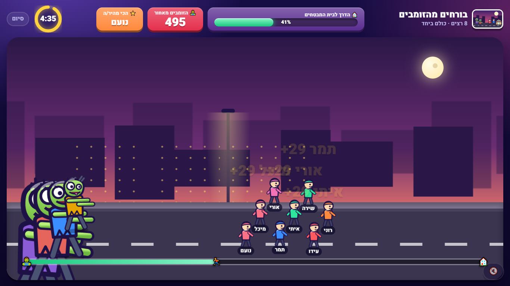
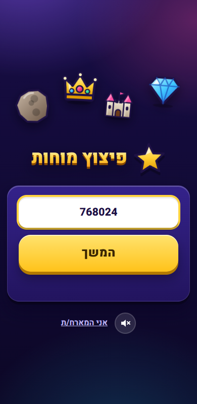
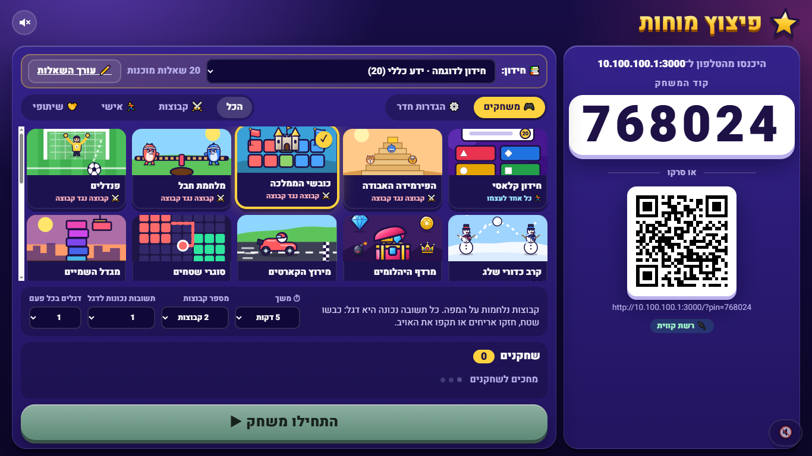

<div dir="rtl" align="right">

# 💥 פיצוץ מוחות · BrainBlast

**משחקי חידון חיים לכיתה.** המורה מקרינה מהמחשב, התלמידים משחקים מהטלפון, וכל תשובה נכונה הופכת לפעולה במשחק: לבעוט פנדל, לכבוש טירה, לברוח מרובוט או לטפס מהר געש.

23 משחקים · קבוצה נגד קבוצה, כל אחד לעצמו, או כל הכיתה יחד · בלי הרשמה, בלי אפליקציה ובלי אינטרנט

### ⬇️ [להורדה (Windows)](https://github.com/tikshuvccna/quiz-games/releases/latest/download/BrainBlast-Windows.zip)

</div>

<p align="center">
  
  
</p>

<div dir="rtl" align="right">

## איך מתחילים? (3 דקות)

1. מורידים את [קובץ ה־zip](https://github.com/tikshuvccna/quiz-games/releases/latest/download/BrainBlast-Windows.zip), קליק ימני ← **"חלץ הכל"**.
2. בתיקייה שנפתחה: לחיצה כפולה על **`start.bat`**.
3. בפעם הראשונה Windows שואל אם לאשר. לוחצים **"כן"** (ואם מופיע "Windows protected your PC": "מידע נוסף" ← "הפעל בכל זאת").

זהו. נפתח מסך עם קוד וקוד QR, התלמידים סורקים מהטלפון ונכנסים. לא צריך להתקין שום דבר: הכול כבר בתוך ה־zip.

**מה צריך:** מחשב Windows 10/11, ורשת Wi-Fi אחת שגם המחשב וגם הטלפונים מחוברים אליה.
מדריך מלא עם תמונות נמצא בתוך התיקייה: `מדריך-פיצוץ-מוחות.pdf`.

## המשחקים

| כל הכיתה יחד 🤝 | קבוצה נגד קבוצה ⚔️ | כל אחד לעצמו (או בקבוצות) 🏃 |
|---|---|---|
| 🤖 בורחים מהרובוט | 🔺 הפירמידה האבודה | 🎯 חידון קלאסי |
| 🐟 צוללת ההצלה | 🏰 כובשי הממלכה | 💎 מרדף היהלומים |
| 🌋 הרצפה היא לבה | 💪 מלחמת חבל | 🏎️ מירוץ הקארטים |
| 🧟 בורחים מהזומבים | ⚽ פנדלים | 🟩 סוגרי שטחים |
| 🎨 ציור במספרים | ☃️ קרב כדורי שלג | 🏗️ מגדל השמיים |
| ☄️ מגני כדור הארץ | 🃏 זיכרון זוגות | 🎣 דייגים |
| 🐉 קרב הדרקון | 🚢 קרב ספינות | 💣 הפצצה המתקתקת |
| 🚀 טיל לירח | | 🎡 גלגל המזל |

## מה עוד יש

- **עורך שאלות** עם תמונות, וידאו ויוטיוב. סוגי שאלות: אמריקאית, נכון/לא נכון, תשובה פתוחה, סליידר, סידור, נעיצה על תמונה ופאזל.
- **ייבוא שאלות** מאקסל, או פשוט להדביק טקסט חופשי והמערכת מסדרת לבד.
- **דוח לכל תלמיד**: מה ענה בכל שאלה, אפשר להוריד לאקסל.
- מוזיקה, רקעים מונפשים, שמות מצחיקים אוטומטיים, ועד 6 קבוצות.
- התשובות נבדקות רק במחשב של המורה, והעורך נפתח רק בו, כך שתלמידים לא יכולים לראות את התשובות.

<p align="center"></p>

</div>

---

## 💥 BrainBlast (English)

**Live classroom quiz games.** The teacher projects the host screen, students play on their phones, and every correct answer turns into a move in a game: take a penalty, capture a castle, outrun a robot, climb out of a volcano.

23 games: team vs team, everyone for themselves, or the whole class together. No sign-up, no app, no internet needed. The interface is in Hebrew.

**[Download for Windows](https://github.com/tikshuvccna/quiz-games/releases/latest/download/BrainBlast-Windows.zip)**: extract the zip, double-click `start.bat`, allow the firewall prompt once. Students on the same Wi-Fi scan the QR code. Node.js is bundled; nothing to install.

### For developers

Node.js + Express + Socket.IO, plain JavaScript and CSS (no build step). Runs on the local network.

```bash
npm install
node server/index.js        # host screen: http://localhost:3000/host.html
node scripts/smoke-test.js  # bots play a short round of every game
```

The code map, how to add a game and the test suites are in [PROJECT_SUMMARY.md](PROJECT_SUMMARY.md).
